# finesse

**The agent skill for frontend that looks designed, not generated.**

AI coding agents write correct UI that all looks the same: a navy page, a default sans, a blue button, three cards and a table. finesse gives the agent a direction nobody would guess from the brief, shows it the finish to match, and makes it look at its own screenshots before it says done.

```
npx skills add Justmalhar/finesse-skill
```

Works with Claude Code, Codex, Cursor and any agent that reads Agent Skills. Node 18 or later for the scripts. No API keys, nothing to install.

## Built with finesse

Twenty niches, each built by an agent from a one-paragraph brief with finesse loaded. No two share a palette or a type pairing, because the dealer was told what it had already dealt. Every page is static HTML in [`examples/`](examples/README.md), with its brief.

<table>
<tr>
<td width="50%"><a href="examples/kubewatch/">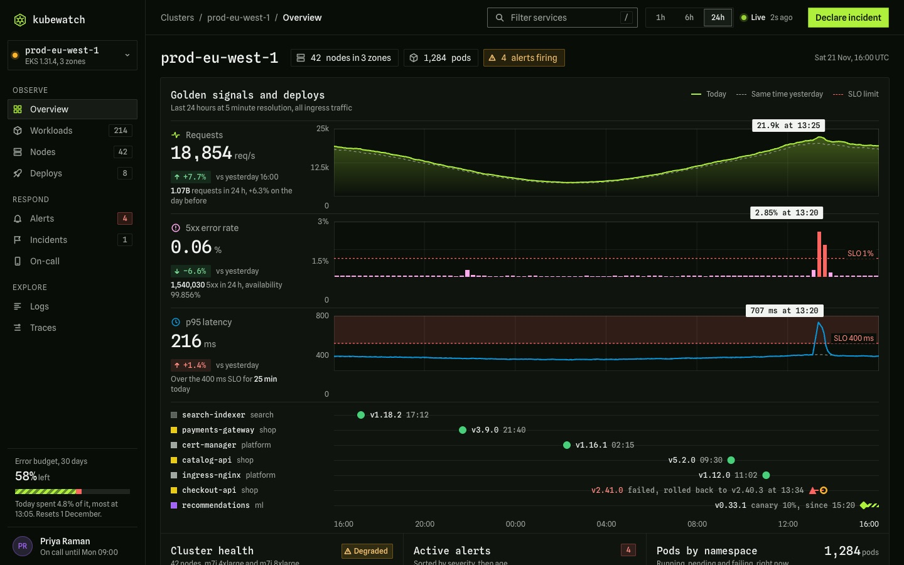</a></td>
<td width="50%"><a href="examples/casa-salina/">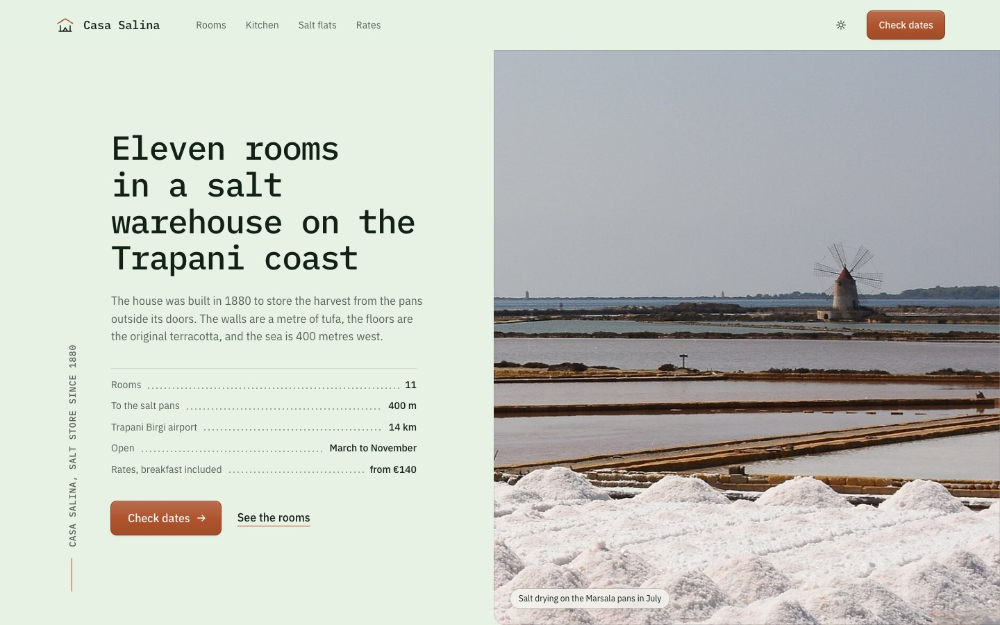</a></td>
</tr>
<tr>
<td><b>Kubewatch</b>. Kubernetes observability dashboard where request rate, errors, latency and per service deploy lanes share one 24 hour axis, set in a basalt and lime ledger.</td>
<td><b>Casa Salina</b>. Website for an eleven room hotel in a Sicilian salt warehouse, in pale sage and terracotta with a stencilled mono type, spine labels and dot leaders.</td>
</tr>
<tr>
<td width="50%"><a href="examples/nachtwerk/">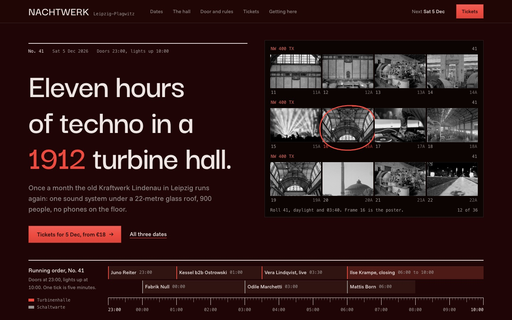</a></td>
<td width="50%"><a href="examples/petal/">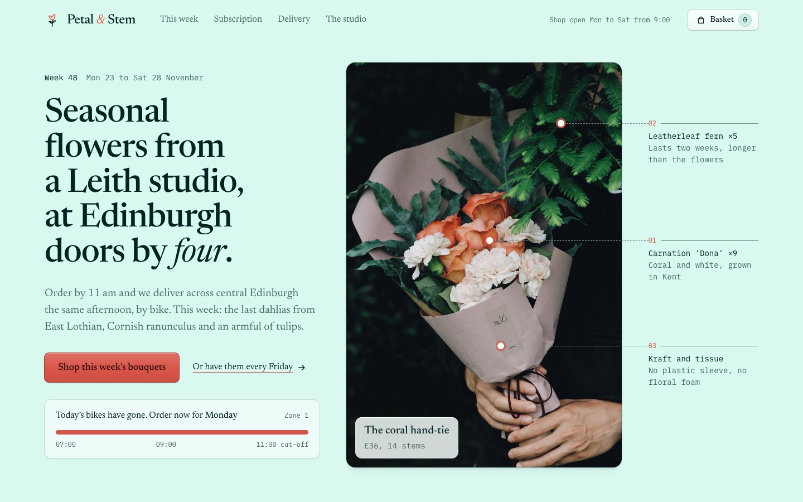</a></td>
</tr>
<tr>
<td><b>Nachtwerk</b>. Event page for a monthly techno night in a Leipzig power station, set like a darkroom contact sheet with the running order drawn as a ruler.</td>
<td><b>Petal &amp; Stem</b>. Online shop for an Edinburgh florist in mint and coral, with a newspaper serif, mono margin notes pinned to the bouquet and a same day cut-off counter.</td>
</tr>
<tr>
<td width="50%"><a href="examples/pennywise/">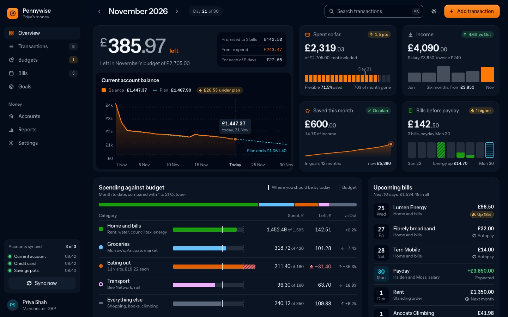</a></td>
<td width="50%"><a href="examples/atelier-vos/">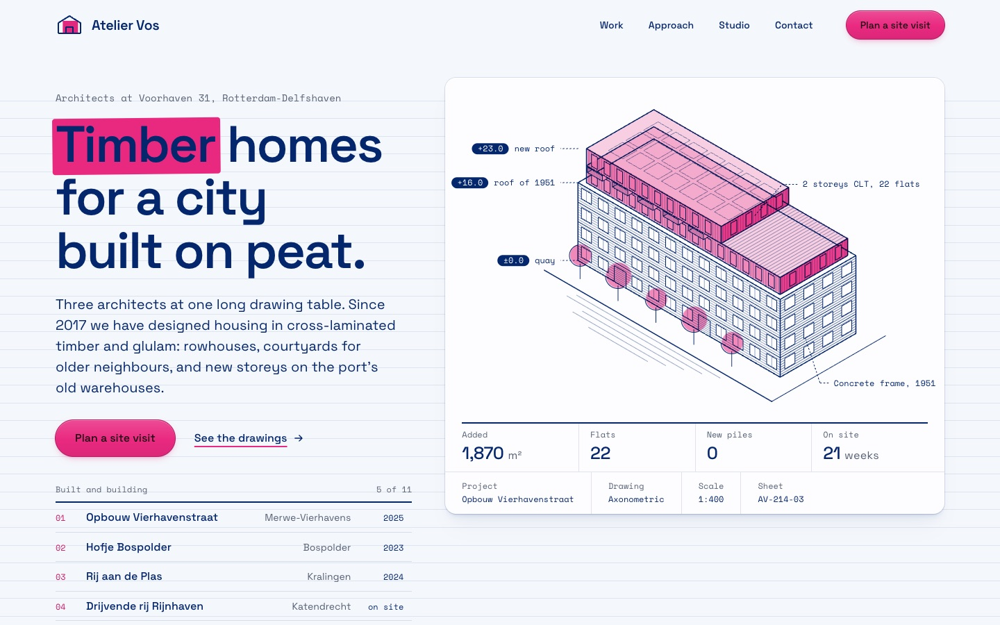</a></td>
</tr>
<tr>
<td><b>Pennywise</b>. Budgeting dashboard in night navy and hot tangerine that leads with what is left this month and runs the balance against a dashed plan line.</td>
<td><b>Atelier Vos</b>. Portfolio for a Rotterdam timber housing studio, printed like a risograph zine in blue and fluorescent pink, each project told through its own drawing.</td>
</tr>
<tr>
<td width="50%"><a href="examples/quinta/">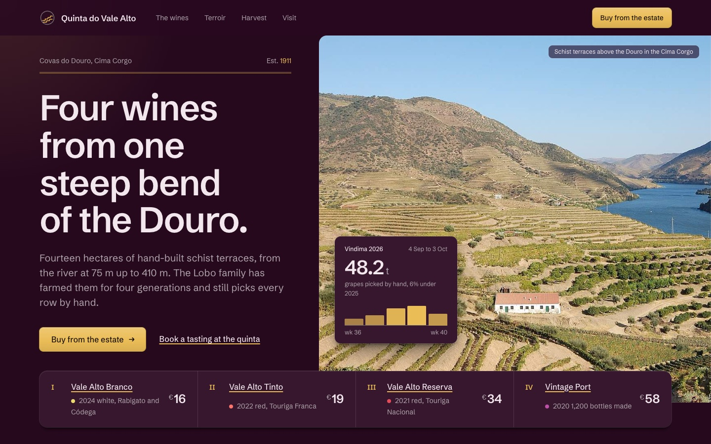</a></td>
<td width="50%"><a href="examples/quill-ai/">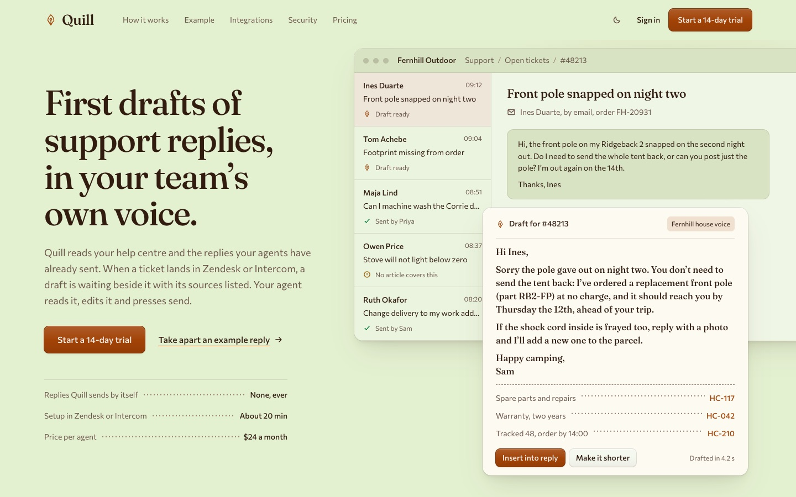</a></td>
</tr>
<tr>
<td><b>Quinta do Vale Alto</b>. A Douro wine estate printed like a theatre programme in plum black and gold leaf, with drawn bottles, a vintage sheet and a slope section to scale.</td>
<td><b>Quill</b>. Landing page for an AI support reply tool on pistachio paper in Fraunces, with the drafted reply laid out like a letter and dotted leaders through every spec.</td>
</tr>
<tr>
<td width="50%"><a href="examples/cragline/">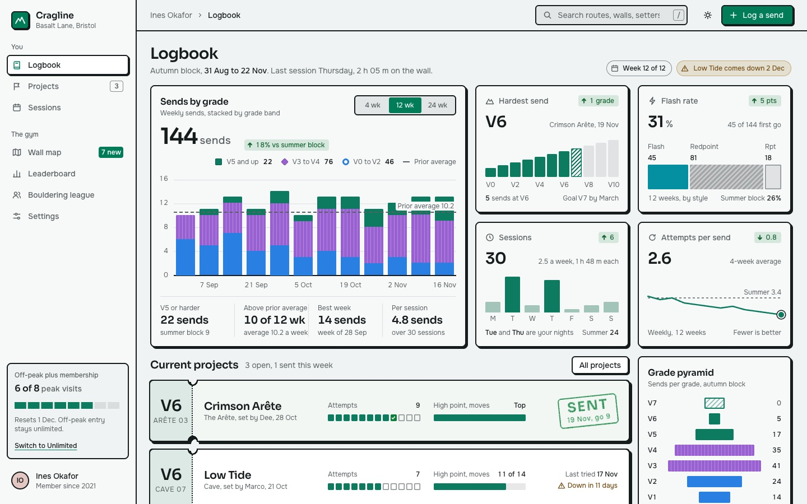</a></td>
<td width="50%"><a href="examples/hollowlight/">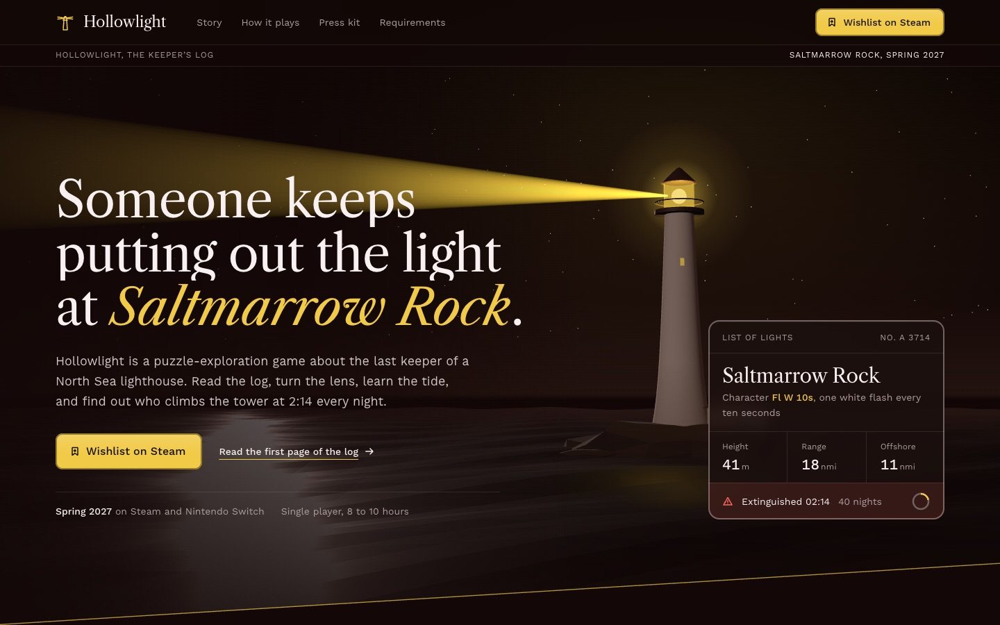</a></td>
</tr>
<tr>
<td><b>Cragline</b>. A climbing gym logbook in overcast grey and jade, with hard printed outlines, perforated route tickets and a rubber stamp on the project you just sent.</td>
<td><b>Hollowlight</b>. Launch page for a lighthouse puzzle game in mahogany and lamp gold, with a live three.js beam sweeping the sky.</td>
</tr>
<tr>
<td width="50%"><a href="examples/marginalia/">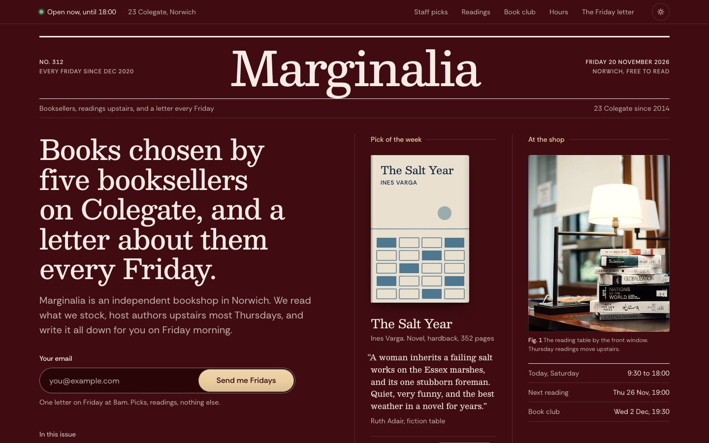</a></td>
<td width="50%"><a href="examples/orbit-kids/">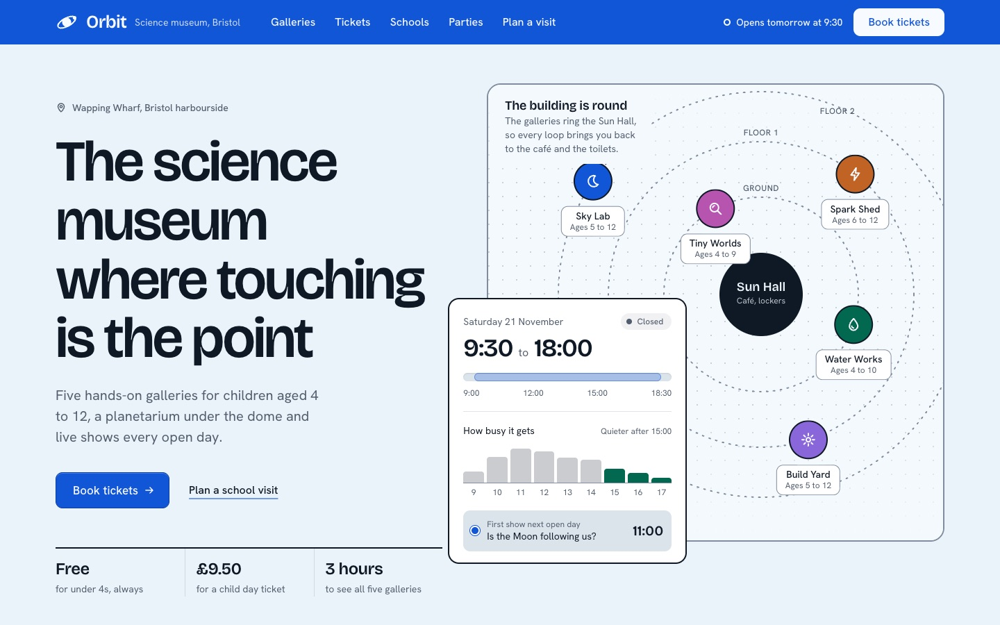</a></td>
</tr>
<tr>
<td><b>Marginalia</b>. A Norwich bookshop and its Friday newsletter, set like a broadsheet front page in champagne Clarendon on oxblood, with drawn book covers.</td>
<td><b>Orbit</b>. A children's science museum in ice white with a cobalt nav band, the building drawn as an orbit map and the five galleries switched with folder tabs.</td>
</tr>
<tr>
<td width="50%"><a href="examples/soundcheck/">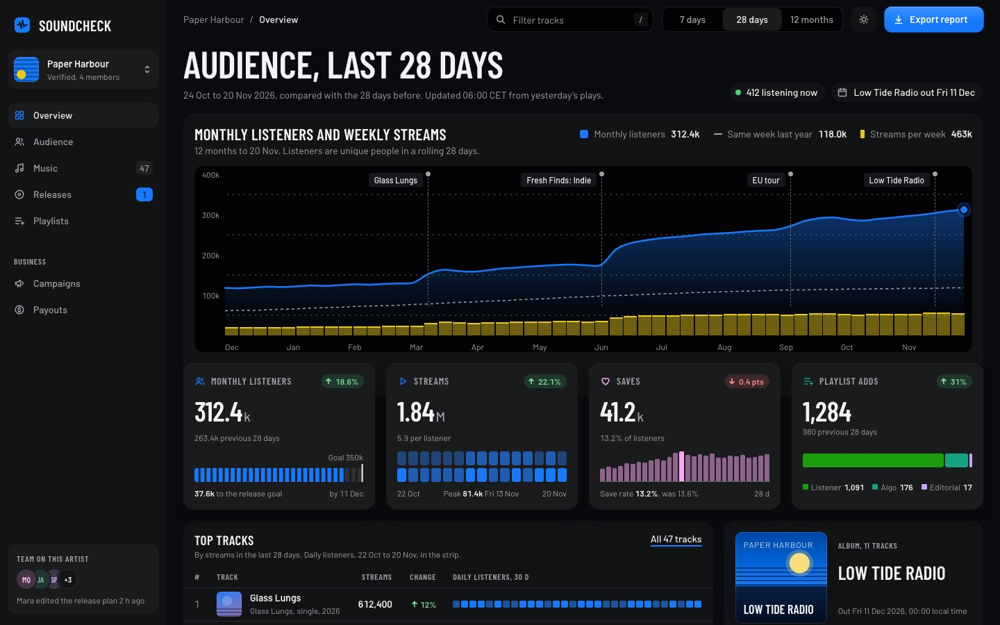</a></td>
<td width="50%"><a href="examples/pasteis/">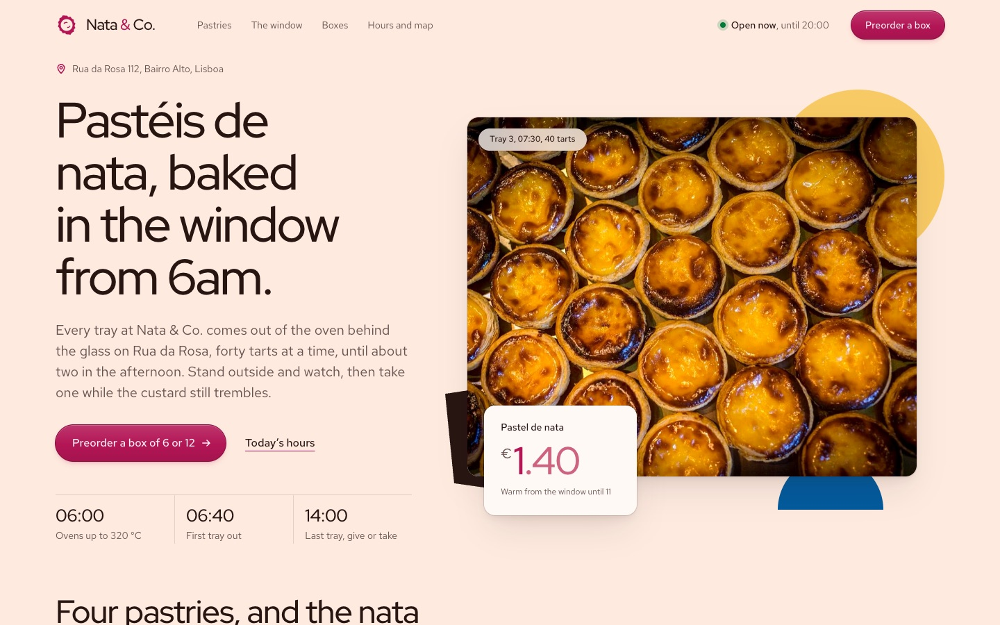</a></td>
</tr>
<tr>
<td><b>Soundcheck</b>. Artist analytics in carbon and electric blue with condensed signage type, built around a full width listener chart, heat strips per track and a release countdown.</td>
<td><b>Nata &amp; Co.</b>. Landing page for a Lisbon pastéis de nata bakery in peach and raspberry, with cut paper shapes around a tray straight from the oven.</td>
</tr>
<tr>
<td width="50%"><a href="examples/vector-cli/">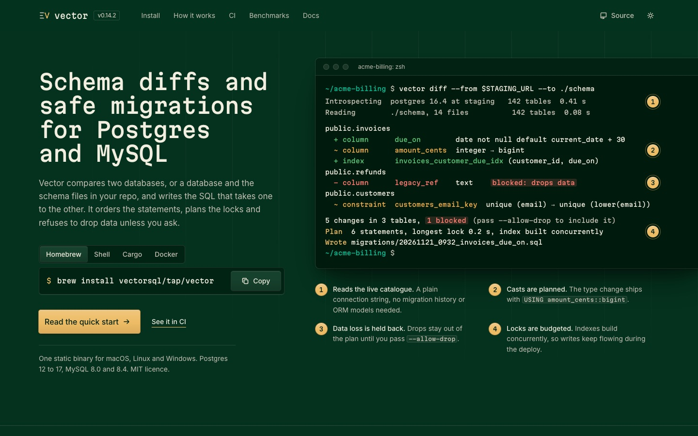</a></td>
<td width="50%"><a href="examples/stride/">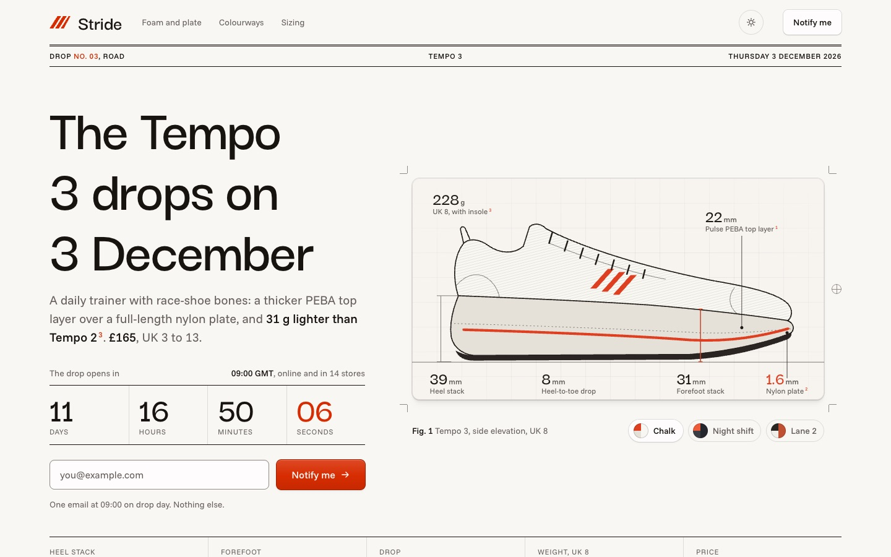</a></td>
</tr>
<tr>
<td><b>Vector</b>. Landing page for an open source schema diff tool in bottle green and brass, with a wide mono headline and an annotated terminal as the hero.</td>
<td><b>Stride</b>. A running shoe drop set like a vermilion and black ink broadsheet, with the shoe drawn as an annotated technical proof inside printer's crop marks.</td>
</tr>
<tr>
<td width="50%"><a href="examples/modular/">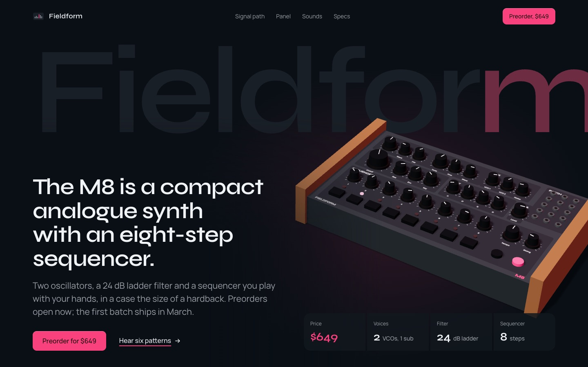</a></td>
<td width="50%"><a href="examples/clinic/">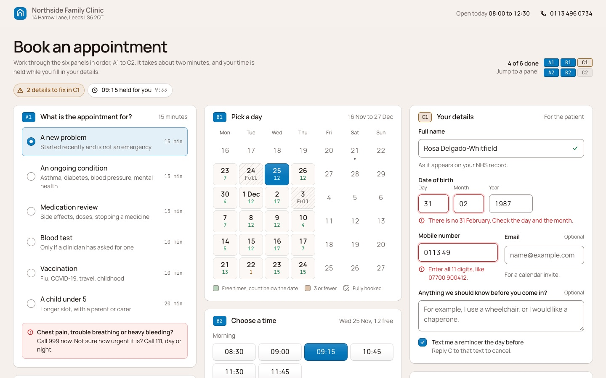</a></td>
</tr>
<tr>
<td><b>Fieldform M8</b>. Launch page for a compact analogue synth on cool slate, with a live three.js model, a pinned scope that walks the signal path and patterns you can play.</td>
<td><b>Northside Family Clinic</b>. Appointment booking laid out as a calm board of six panels, A1 to C2, with validation, a fully booked day and a confirmation screen.</td>
</tr>
<tr>
<td width="50%"><a href="examples/deepwater/">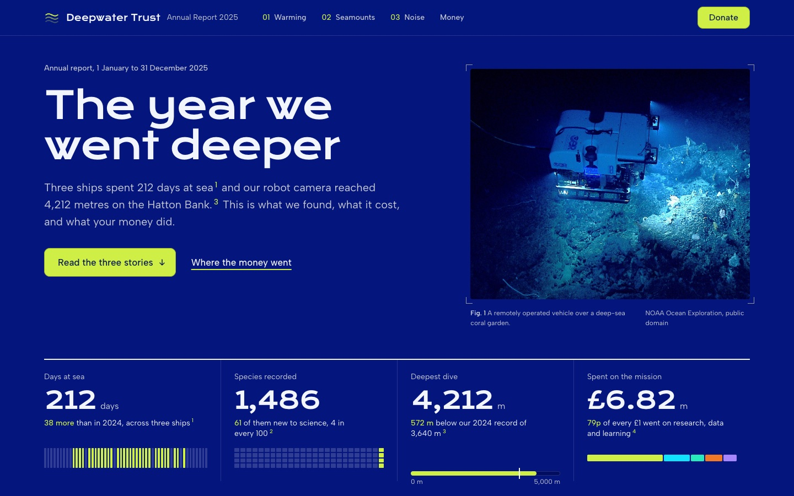</a></td>
<td width="50%"><a href="examples/ramen/">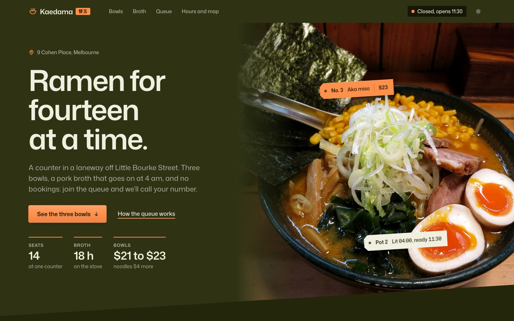</a></td>
</tr>
<tr>
<td><b>Deepwater Trust</b>. Annual report for a marine research charity in Klein blue and chartreuse, with a warming chart, a sonar map and every claim footnoted to its source.</td>
<td><b>Kaedama</b>. Website for a fourteen seat Melbourne ramen counter in olive drab and blaze orange, with the sections cut on a diagonal and order tags on the bowl.</td>
</tr>
</table>

Photographs are from Wikimedia Commons and Unsplash under their licences, credited in each page's `CREDITS.md`. Everything else is drawn in HTML, CSS, SVG or three.js. Names, places and figures are invented.

<table>
<tr>
<td width="50%">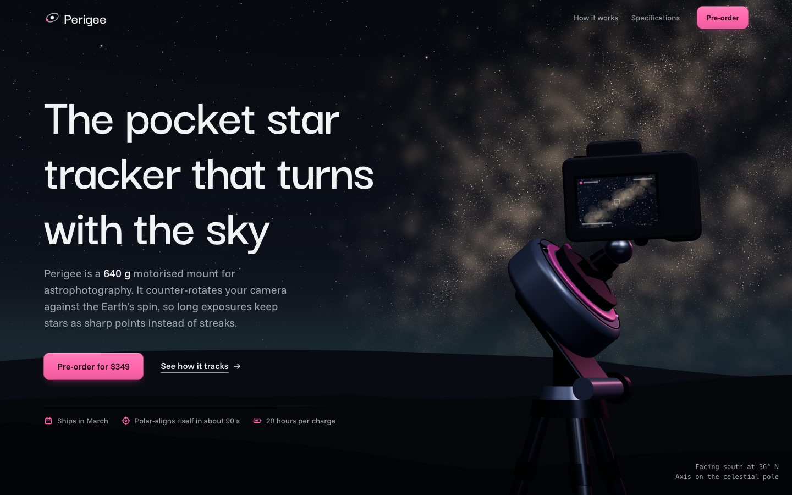</td>
<td width="50%">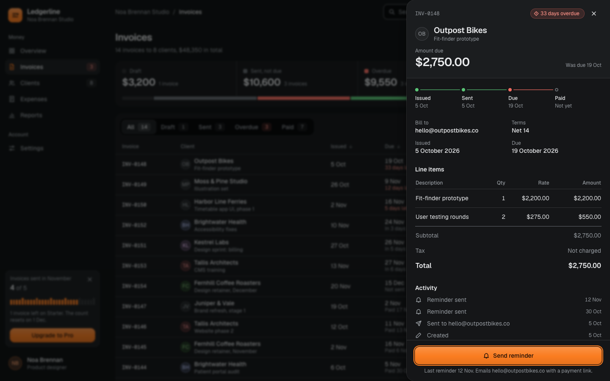</td>
</tr>
<tr>
<td><b>Perigee</b>, built with <code>/finesse showpiece</code>. A three.js sky of about 60,000 stars, a modelled star tracker, and GSAP scroll moments, with a static poster under reduced motion.</td>
<td><b>Ledgerline</b> invoice sheet. Focus moves in and returns on close, and the reminder button runs idle, loading and success without changing width.</td>
</tr>
<tr>
<td>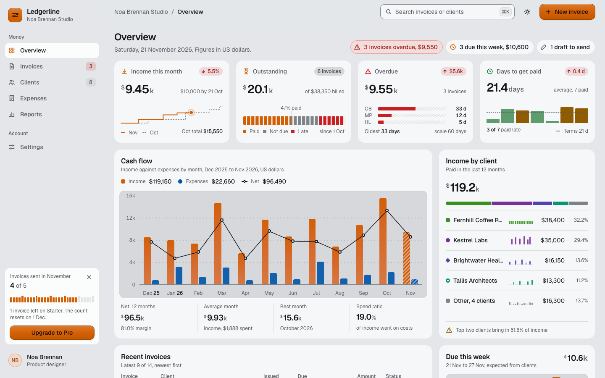</td>
<td>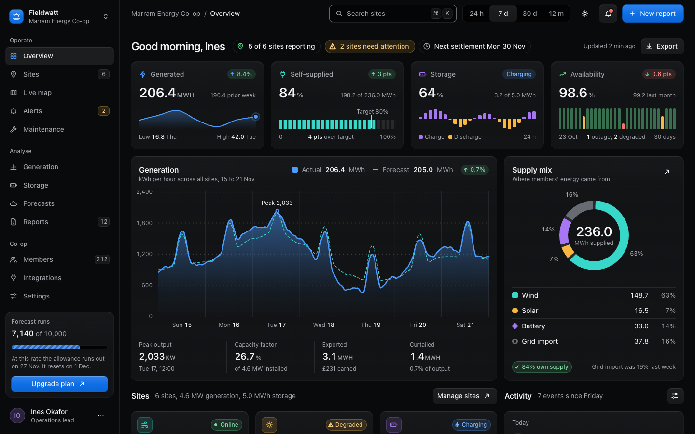</td>
</tr>
<tr>
<td><b>Ledgerline</b> in light. Both themes are designed, not inverted.</td>
<td>The <b>dashboard exemplar</b> that ships inside the skill. Agents read it to see the finish to match, then build something else.</td>
</tr>
</table>

## Same brief, same model, with and without

Each pair below was built by the same model (Claude Opus, high effort) from the same one-paragraph brief. The only difference is whether the finesse skill was loaded. The briefs and all the source are in [`examples/`](examples/README.md), so you can rerun them.

<table>
<tr>
<th width="50%">Without a design skill</th>
<th width="50%">With finesse</th>
</tr>
<tr>
<td>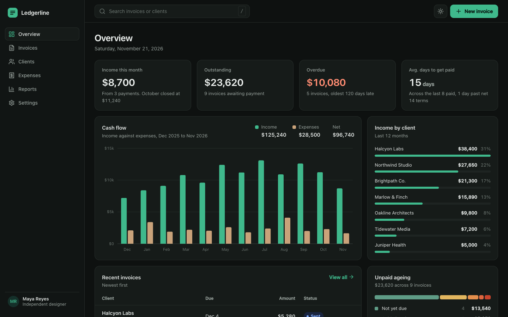</td>
<td>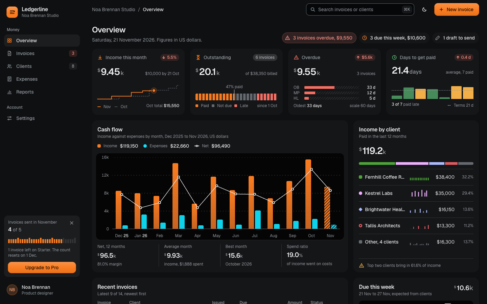</td>
</tr>
<tr>
<td colspan="2"><b>Ledgerline</b>, a dashboard for an invoicing app. Without the skill, each tile is a bare number and every chart is one colour. With it, each figure has a comparison and its own visual, series colours keep one meaning across the screen, and charts sit in sunken wells.</td>
</tr>
<tr>
<td>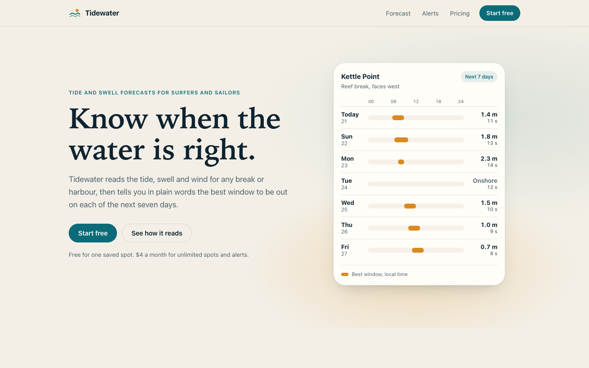</td>
<td>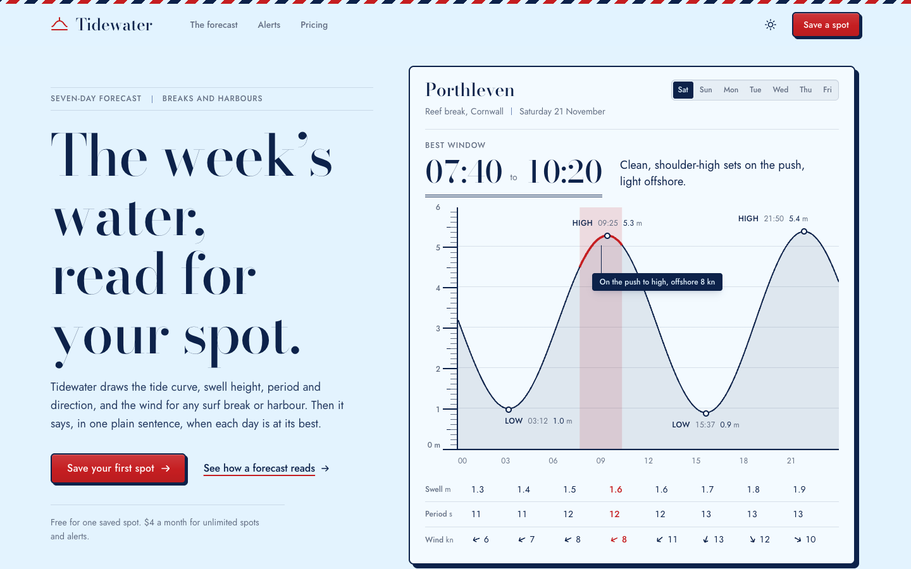</td>
</tr>
<tr>
<td colspan="2"><b>Tidewater</b>, a landing page for a tide and swell forecast app. Without the skill: a cream page, a glow blob, an eyebrow and two pill buttons. With it: a harbour master's tide almanac sent by air mail, with a tide-staff ruler as the chart's real axis.</td>
</tr>
</table>

## Why agents produce the same page every time

1. **They choose from memory.** Asked to pick a palette and a typeface, a model picks the most likely one, and so does every other run. Rules against "generic" do not help, because the next most likely choice is just as shared.
2. **Nobody shows them finished work.** A model reproduces the level of finish it is shown. A list of rules shows it none.
3. **They never look.** A linter passes a page whose chart labels overlap and whose empty state is showing beside real data.

## How finesse fixes each one

1. **It deals a direction.** A script draws three candidate directions from a library of 36 palettes, 36 type pairings, 12 shape systems and 52 signature details, filtered by what the brief is (a dashboard, a landing page, docs). The agent picks the one that fits. Two runs on the same brief differ.
2. **It shows the finish.** Five hand-finished exemplars (controls, surfaces, data, marketing, dashboard) and a craft guide with exact CSS for depth, edges, numerals, charts and states. The agent reads one before it builds.
3. **It makes the agent look.** The workflow ends with screenshots at desktop and phone widths, scored on a rubric, with up to three fix rounds. Then a zero-dependency checker catches the floors and the tells.

```
/finesse build      design and build new UI
/finesse polish     raise an existing UI to the craft bar
/finesse audit      read-only review, ranked findings
/finesse like stripe    build in the style of a bundled design system
/finesse showpiece  GSAP, three.js and parallax, with budgets
```

## What is in the box

| Part | What it does |
|---|---|
| `SKILL.md` | The workflow, the number set (type, colour, space, motion, states) and the default tells to avoid. |
| Direction dealer | `scripts/direct.mjs "<brief>"` prints three candidates, then `--emit <id>` prints a complete token block: OKLCH roles for light and dark, six chart colours, type scale, radius and shadow. |
| Palettes | Every one is validated for contrast in both themes, for staying inside sRGB, and for chart series that stay distinguishable under simulated protanopia and deuteranopia. |
| Exemplars | Five reference pieces that re-theme with any palette and show every state. They set a level of finish, never a look. |
| References | Craft, dashboards, components, motion, surfaces, foundations, the catalogue of tells, glass materials, and the showpiece tier. Each loads only when its trigger applies. |
| Showpiece tier | GSAP ScrollTrigger and three.js patterns with budgets (one scene, three scroll moments, two pins) and floors (native scroll, reduced motion, poster fallback, full disposal). |
| 84 design systems | `like <brand>` reads one bundled DESIGN.md and builds in that style. See the notice below. |
| Checker | `scripts/check.mjs` scans source in any stack, including Tailwind class strings. 29 rules, each with passing and failing fixtures. |

### The checker

```
node skills/finesse/scripts/check.mjs src/
```

```
page.html:1  warn  default-gradient  violet/indigo/purple gradient (the default AI palette)  (fix: use the brand accent as a flat fill, or a gradient within one hue family)
page.html:1  error  transition-all  transition on all properties  (fix: list the properties, for example transition: opacity 200ms, transform 200ms; Tailwind transition-colors / transition-opacity / transition-transform)
FINESSE: FAIL 1 errors, 1 warnings
```

Errors are things wrong in every design: removed focus outlines, animated layout properties, text under 12 px, placeholder residue. Warnings are default tells a brief can legitimately ask for, and a one-line waiver with a reason silences one. It reads source, not pixels, so a pass says nothing about craft. The screenshot step does that.

## Install

**Any agent, through the skills CLI** (needs Node 22.20 or later):

```
npx skills add Justmalhar/finesse-skill
```

<details>
<summary>Claude Code plugin</summary>

```
/plugin marketplace add Justmalhar/finesse-skill
/plugin install finesse@finesse-skill
```
</details>

<details>
<summary>Manual copy</summary>

Copy `skills/finesse/` into your agent's skills folder:

| Agent | Folder |
|---|---|
| Claude Code | `.claude/skills/` or `~/.claude/skills/` |
| Codex, Cursor, Gemini CLI, Copilot and others | `.agents/skills/` |
</details>

Then ask for what you want: "build the dashboard for my invoicing app", "this page looks generic, polish it", or "landing page like linear".

## The bundled design systems

The 84 DESIGN.md files come from [VoltAgent/awesome-design-md](https://github.com/VoltAgent/awesome-design-md), redistributed unmodified under its MIT licence. They are independent analyses of publicly visible styling, not official design systems. finesse is not affiliated with or endorsed by any company named in them. It takes colour, type, spacing and shape from a file, never logos, licensed fonts, copy or page layouts, and it refuses to build a page meant to pass as the real brand. Details and removal requests: [`NOTICE.md`](skills/finesse/design-systems/NOTICE.md).

## Limits

- The demos above were judged in Chrome. Safari and Firefox are less tested.
- The checker reads source text. It cannot see overlapping labels, clipped content or contrast over an image.
- The dealer makes pages differ from each other. It does not replace a real brand: when your project has a design system, finesse uses it and skips the dealer.
- Results depend on the model. The skill was developed and tested with Claude.

## Credits

finesse learned from the skills that came before it: [taste-skill](https://github.com/Leonxlnx/taste-skill) for showing that an enforced finish step works, [impeccable](https://github.com/pbakaus/impeccable) for the register split and its detector, Emil Kowalski's writing on motion, and [Watermelon UI](https://ui.watermelon.sh) for setting the bar on component and dashboard polish. No code from any of them is included.

## Contributing

New palettes, type pairings, signatures and checker rules are welcome. Each needs to pass validation or ship fixtures. See [`CONTRIBUTING.md`](CONTRIBUTING.md) and [`AGENTS.md`](AGENTS.md).

## Licence

MIT, copyright 2026 [Malhar Ujawane](https://github.com/justmalhar). The bundled design systems carry their own MIT licence from VoltAgent.
