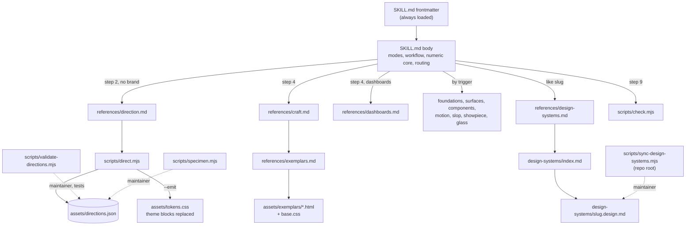

# finesse: system design

This document describes how the finesse skill works as a system: what loads when, what each script does, and the data each script reads and writes. Version 0.1.0.

## Requirements

### Functional

- Route the agent by mode (`build`, `audit`, `polish`, `like <slug>`, `showpiece`) and by register (`marketing` or `product`).
- Deal candidate directions from a fixed library, filtered by register and surface, weighted by the brief, and emit a token block for the chosen candidate as CSS or Tailwind v4.
- Avoid dealing the same palettes and type pairings as the last three unseeded runs in the same project.
- Lint source files for accessibility floors and default tells, with line-level findings, an exact pass or fail line and an exit code.
- Allow a finding to be waived in source, only with a known rule id and a reason.
- Provide 84 brand design systems for `like <slug>` mode, reproducible from a pinned upstream commit.

### Non-functional

- No run-time dependencies. Every script is one Node file using only built-in modules. Node 18 or later.
- No network at run time, except `validate-directions.mjs --fonts`, which is a maintainer check.
- Deterministic output where it matters: a seeded deal is repeatable, the checker is pure over its input files, and the design-system sync is byte-identical at the same upstream commit.
- Small always-loaded context. Only the frontmatter loads at session start. The `SKILL.md` body loads on invocation, and each reference loads only when its trigger applies.
- The project's own design system takes precedence over finesse defaults. Accessibility floors never lift.

## High-level design

Solid arrows are what the agent reads or runs during a task. Dotted arrows are maintainer tools.

### Workflow

`SKILL.md` defines ten steps. The agent runs them in order.

1. Read the room: stack, tokens, fonts, components, any `DESIGN.md`. Pick the register. A product dashboard is dense and colourful by default.
2. Deal a direction with `direct.mjs` when the project has no brand, and write the direction block before any code. The dealt direction outranks general finesse defaults; accessibility floors outrank both.
3. Write tokens first: copy `assets/tokens.css` into a new project, then paste the two sections of `direct.mjs --emit <id>`, or map them onto the project's token system.
4. Read `references/craft.md`, the one exemplar file `references/exemplars.md` names, `base.css`, and `references/dashboards.md` for a dashboard.
5. Build with real content and every state. Controls the brief names but does not specify work minimally or are reported as inert.
6. Craft pass: compare the result with the exemplar's finish and close the gap.
7. Motion pass, then confirm the reduced-motion path.
8. Screenshot at 1440 and 390 px in each needed theme, check 320 px for overflow, and score against the rubric (8 rows, 9 on a dashboard). At most 3 rounds of one look and one set of fixes.
9. Run the checker, fix, rerun. At most 3 rounds.
10. Report in the fixed format, with labelled rubric scores.

## Low-level design

### The dealer and its data

`assets/directions.json` holds one library with these top-level keys:

| Key | Contents |
|---|---|
| `version` | Library format version, currently 1. |
| `registers` | `["marketing", "product"]`. |
| `surfaces` | 8 surfaces, each with the registers it belongs to and the brief keywords that name it: `dashboard`, `app`, `table`, `settings` (product), `landing`, `pricing` (marketing), `article`, `docs` (both). |
| `default_surfaces` | The surfaces a register falls back to when the brief names none: product `app, dashboard`, marketing `landing`. |
| `tags` | 26 tag names, each with the brief keywords that match it. |
| `palettes` | 36 entries, `P01` to `P36`. Each has `base` (light or dark first), `strategy` (restrained, tinted, committed), `accent_text_safe` per theme, and `light` and `dark` maps of the 13 colour roles plus `chart-1` to `chart-6`, in OKLCH. The product palettes `P27` to `P36` are dark-first with three stepped grounds and a light theme. |
| `type` | 36 entries, `T01` to `T36`. Each has `display`, `text` and optional `mono` families with fallbacks and weights, `tracking`, a scale `ratio` per register, `classification`, `tabular` (both faces have tabular figures), a Google Fonts `css` URL, `source` and `license`. |
| `shape` | 12 entries, `S01` to `S12`. Each has `radius`, `elevation`, `density`, a `tokens` map (`--r-control`, `--r-card`, `--r-modal`, `--border-width`, `--control-h`, `--pad-card`, `--gap-group`) and `--elevation-1` to `--elevation-3` per theme. |
| `signature` | 52 entries, `G01` to `G52`. Each has `what` and `build` text, and optional `needs`: brief keywords it cannot be built without (`photo`), so a brief that negates one rules it out. |

Every entry also has `id`, `name`, a `character` line (signatures use `what`), `registers`, `surfaces`, `tags` and optional `clashes`: ids it must never share a candidate with.

**Reading the brief.** The brief is split into clauses at punctuation, "and" and "but". A negator (no, not, without, never, avoid and others) negates the next three words of its clause. Tag and surface keywords match whole words, with plural forms. Negated matches count for nothing and are listed in the output.

**Placement.** `--register` wins; without it the register is inferred when every named surface belongs to one register, and the dealer stops otherwise. `--surface` overrides the surfaces read from the brief; with none, the register's `default_surfaces` apply.

**Eligibility.** One rule for every axis: the entry lists the register, lists at least one placed surface, and has no `needs` the brief negated. Weight is `(1 + 4 × matched tags) × (1 + 2 × matched surfaces)`. `--explain <id>` prints this per entry, plus clashes inside the id.

`direct.mjs` deals in four steps.

1. Place the brief: register, surfaces, tags and negated phrases.
2. For each axis, keep eligible entries outside `--avoid`, outside entries already dealt this run, and free of clashes with the candidate's earlier picks. Palettes and type pairings dealt in the last 3 runs recorded in `.finesse/history.json` are dropped when fresh entries remain. If a rare surface leaves an axis empty, the register's default surfaces widen the pool and the output says so.
3. Draw by weight, times `0.35 ^ repeats`, where repeats counts spread properties shared with entries already dealt: `base` and `strategy` for palettes, `classification` for type, `elevation` and `radius` for shapes.
4. Zip the draws into candidates (three by default) and append the run to history, which keeps the last 20 runs.

A seeded run (`--seed <n>`) uses a fixed PRNG and ignores history, so the same seed and brief always deal the same hand. A history write that fails, for example in a read-only directory, is ignored.

**Candidate id.** `P<nn>-T<nn>-S<nn>-G<nn>-G<nn>`: one palette, one type pairing, one shape and two signatures, for example `P27-T29-S11-G37-G42`. `--emit` needs the P, T and S parts; G parts are optional and add their build notes to the header comment.

**Emit output.** Two sections. Section 1 is the Google Fonts `@import`, which goes on the first line of the stylesheet. Section 2 starts at the `/* 2. Tokens:` marker and replaces the theme blocks of `assets/tokens.css`: a comment with the direction's character, signature build notes, accent-as-text safety, the chart order and the `<link>` tags for loading fonts from `<head>`; a `:root` block (brand hue, font stacks, weights, display tracking, the type scale from the pairing's ratio, shape tokens); the palette's base theme on `:root, [data-theme="<base>"]`; and the other theme twice, under `prefers-color-scheme: <other>` for `:root:not([data-theme="<base>"])` and on `[data-theme="<other>"]`. Every theme block carries the 13 roles, `--chart-1` to `--chart-6`, the shadow colour and the shape's elevations. `--format tailwind` adds an `@theme inline` block and a `dark` custom variant.

### Direction validation

`validate-directions.mjs` checks the library and exits 1 on any error.

- Minimum counts: 24 palettes, 20 type pairings, 8 shapes, 30 signatures, and at least 10 palettes, 8 type pairings and 12 signatures placed on product dashboards. Ids match `P01`, `T01`, `S01` or `G01` patterns and are unique.
- Every entry's registers, surfaces, tags, clashes and needs refer to things that exist, and every register it claims is reachable through one of its surfaces.
- Every palette defines exactly the 13 roles and `chart-1` to `chart-6` in both themes, in OKLCH, inside the sRGB gamut, opaque except `border`.
- Contrast floors per theme: `text`, `text-muted`, `danger`, `success` and `warning` at 4.5:1 on all three surfaces; `accent`, `border-strong` and `focus` at 3:1; `accent-text` at 4.5:1 on `accent`. `text` and `text-muted` also hold 4.5:1 on the hover, selected and well tints the craft recipes put them on. `accent_text_safe` must equal the computed value.
- `text` and `text-muted` differ by at least 0.12 in OKLCH lightness, so muted text reads as a second level.
- Chart series: 3:1 on surfaces, chroma 0.08 or more, no brown or olive oranges and yellows, neighbours 50 degrees apart, alternating in lightness, and apart under normal vision, protanopia and deuteranopia; no two series near duplicates; `chart-1` within 30 degrees of a chromatic accent.
- A dashboard palette's dark grounds step 0.02 or more from page to tile to popover. Two palettes with the same base, accent and ground are near duplicates.
- A violet accent (hue 275 to 325 with chroma above 0.05) is an error.
- Type: at most 2 families and 3 weights, no 800 or 900, display weight at most 600, tracking from -0.04 to -0.02, ratio inside the register's range, at most one pairing using Inter, Roboto, Open Sans, Poppins or Montserrat, and tabular figures on any pairing placed on a dashboard or table.
- Shape: card radius at most 24 px, padding and group gap on the spacing scale, three elevations per theme.
- No string anywhere contains an em dash, en dash, middle dot or bullet.

`--fonts` also fetches every stylesheet, confirms each family is served, and reads the TrueType tables to confirm the `tabular` claim. `--json` prints machine output.

### The checker

`check.mjs` is a rule table plus an engine.

**Rule shape.** Each entry in the exported `rules` array has `id`, `severity` (`error` or `warn`), `kinds` (which of `css`, `markup`, `script`, `md` it reads), `message`, `fix`, `why`, optional `misses`, optional `copy: true` for copy rules, optional `project: true` for rules that see all files at once, and a generator `detect(ctx)` that yields hits with an offset.

**Engine.**

1. Collect files by extension. Directory walks skip `node_modules`, `design-systems`, `vendor`, `dist`, `build`, `out`, `coverage`, fixture folders, dot directories, symlinks, minified files and files of 1 MB or more. A file named on the command line skips the size and minified-file filters.
2. Build a context per file: comments blanked with offsets kept, so line numbers stay true. Markdown also blanks fenced code, inline code and link targets. CSS blocks, class lists (including `cn`, `clsx`, `cva` and similar calls) and copy segments are parsed lazily.
3. Collect project-wide facts, currently the set of classes that carry a focus style.
4. Run each active rule over the files of its kinds.
5. Drop findings waived on the same or previous line by `finesse-ignore <rule-id>: <reason>` with a known id and a reason of 8 or more characters. An invalid waiver is itself an error and waives nothing. Deduplicate by file, line and rule.

**Rules.** 29 in 0.1.0: 12 errors (floors such as `outline-removed`, `tiny-text`, `motion-no-reduced`, `img-no-alt`) and 17 warnings (tells such as `default-gradient`, `side-stripe`, `slop-copy`, `href-hash`, `display-leading`). `--rules` lists them with their reason and known limits.

**Output contract.** One line per finding, `file:line  severity  rule-id  message  (fix: ...)`, sorted by file, line and rule. The last line is exactly `FINESSE: PASS` or `FINESSE: FAIL <n> errors, <m> warnings`. Exit code 0 when no errors remain (warnings alone pass), 1 with errors, 2 on a usage error. `--json` prints `{ files, findings, errors, warnings }`. `--only`, `--skip` and `--copy-only` select rules.

### Design-system sync

`scripts/sync-design-systems.mjs` lives at the repo root and is never shipped to users' agents as a run-time step.

1. Fetch VoltAgent/awesome-design-md at `--ref` (default `main`) with a shallow git fetch, or read a local clone given with `--source`.
2. Copy each `design-md/<slug>/DESIGN.md` byte for byte to `skills/finesse/design-systems/<slug>.design.md`, skipping slugs in `EXCLUDED`.
3. Copy the upstream `LICENSE`. Delete any file in the folder that is neither a vendored file nor one of `index.md`, `NOTICE.md`, `LICENSE` and `SOURCE.json`.
4. Write `SOURCE.json`: `upstream`, `commit`, `date` (the upstream commit date, never the wall clock), `count`, and a SHA-256 for every vendored file and the license.
5. Write `index.md`: one table per upstream README category, each row `slug | format | character`. The character line comes from the hand-reviewed `OVERRIDES` map, or is derived from the file, at most 14 words, with no dash or dot separators and no pipes.

The `.design.md` suffix exists because a vendored `claude.md` would collide with `CLAUDE.md` on case-insensitive filesystems, and agent harnesses auto-load `CLAUDE.md` as instructions.

### Token roles

Components use only these 13 colour roles, each defined for light and dark: `background`, `surface`, `surface-raised`, `border`, `border-strong`, `text`, `text-muted`, `accent`, `accent-text`, `danger`, `success`, `warning`, `focus`. Data series use `chart-1` to `chart-6`, outside the one-accent rule. `assets/tokens.css` defines them on `:root` and `[data-theme="light"]`, overrides them under `prefers-color-scheme: dark` unless `data-theme="light"` is set, and again on `[data-theme="dark"]`. It also holds the type, space, radius, elevation and motion tokens and a named z-index scale (`--z-base`, `--z-sticky`, `--z-dropdown`, `--z-overlay`, `--z-modal`, `--z-toast`, `--z-tooltip`). `direct.mjs --emit` produces blocks with the same selectors (swapped for a dark-first palette), so its output pastes over the starter theme blocks.

## File map

| Path | Role |
|---|---|
| `skills/finesse/SKILL.md` | Entry point and source of truth for every number. |
| `skills/finesse/references/` | Twelve on-demand references, routed by the table in `SKILL.md`. |
| `skills/finesse/scripts/direct.mjs` | Direction dealer and token emitter. |
| `skills/finesse/scripts/check.mjs` | Checker. |
| `skills/finesse/scripts/validate-directions.mjs` | Library validator. |
| `skills/finesse/scripts/specimen.mjs` | Renders the library to one HTML page, written outside the skill folder. |
| `skills/finesse/assets/directions.json` | Direction library. |
| `skills/finesse/assets/tokens.css` | Starter tokens. |
| `skills/finesse/assets/exemplars/` | Five exemplar pages (controls, surfaces, data, marketing, dashboard) and their shared `base.css`. |
| `skills/finesse/design-systems/` | Vendored design systems, `index.md`, `SOURCE.json`, `NOTICE.md`, `LICENSE`. |
| `scripts/sync-design-systems.mjs` | Regenerates `design-systems/`. |
| `.claude-plugin/marketplace.json` | Claude Code marketplace and plugin entry. |
| `tests/` | `node:test` suite and checker fixtures. |
| `examples/` | Example builds. |

## Dependencies

None at run time. The scripts import only `node:fs`, `node:path`, `node:url`, `node:crypto`, `node:os` and `node:child_process`, and need Node 18 or later; the suite passes on Node 18.20. The sync script also needs `git`. There is no `package-lock.json` because there is nothing to install.

## Test strategy

`npm test` runs `node --test tests/*.test.mjs`. CI runs it on Node 18, 20 and 22.

| File | What it proves |
|---|---|
| `tests/check.test.mjs` | Every rule fires on each `fire*` fixture and stays quiet on each `pass*` near miss; line numbers, waivers, exit codes, output format, `--json`, `--only`, `--skip`, `--copy-only`, `--rules` and skipped directories. |
| `tests/directions.test.mjs` | The library validates; the validator rejects broken entries (contrast, gamut, chart series, tints, muted step, surfaces, clashes); deals are well formed, spread, repeatable by seed and placed by register and surface; negated phrases and clashes hold; emitted CSS parses, covers every role, pastes into `tokens.css` and puts a dark-first palette on `:root`. |
| `tests/frontmatter.test.mjs` | Each `SKILL.md` meets the Agent Skills spec: name format and directory match, description length, body length, and that every referenced path exists. |
| `tests/self.test.mjs` | Every Markdown file in the repo, except vendored `*.design.md`, `examples/` and `tests/fixtures/`, passes the checker's copy rules. |
| `tests/manifest.test.mjs` | The marketplace manifest parses, its names and version agree with `package.json`, and every declared path exists. |

## Context budget

Measured with `wc -w` on 2026-11-21. Length is allowed where every sentence changes what the agent builds; there is no word budget.

| Loads | Content | Words |
|---|---|---|
| Always | `SKILL.md` frontmatter | 164 |
| On invoke | `SKILL.md` body | 2,389 |
| On demand, one at a time | Each reference | 602 (`exemplars.md`) to 1,930 (`showpiece.md`); 15,547 for all twelve |
| On demand | One exemplar page | 2,653 to 9,057, plus 2,909 for `base.css` |
| On demand | `design-systems/index.md` | 1,488 |
| On demand | One design system | 669 to 5,588 |
| Never read, only run | Scripts and `directions.json` | Output only |

`claude plugin details finesse` reports about 260 tokens always on. A typical build reads the body, `direction.md`, `craft.md`, `exemplars.md`, one exemplar page and `base.css`; a dashboard adds `dashboards.md`.
